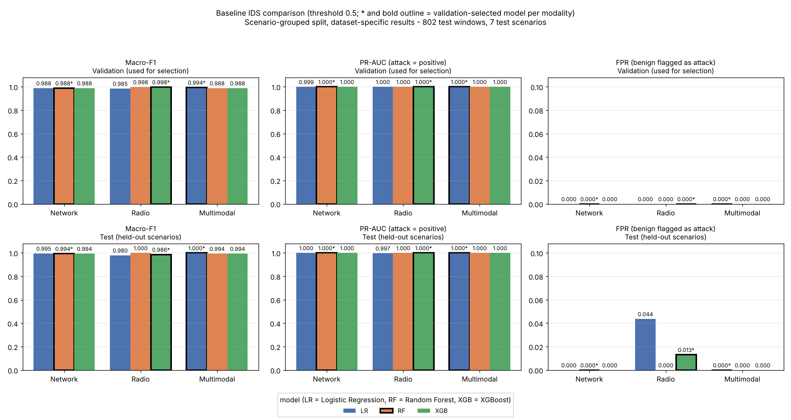

# Baseline IDS Modeling Report (Member 3)

**Project:** *When One Sensor Lies: Robust Multimodal Intrusion Detection Against Inference-Time Telemetry Manipulation in 5G Open RAN*

These are **dataset-specific baseline results** for a binary intrusion-detection task on one set of captures. They are **not** evidence that the models generalise to unseen 5G deployments, other capture sessions, other devices or other attack implementations. The network-radio alignment is at the UTC-second level only; **no packet-to-UE correspondence is claimed**.

## 1. Summary of results (test partition, validation-selected model per modality)

| modality | model | hyperparameters | val_macro_f1 | test_macro_f1 | test_precision | test_recall | test_pr_auc | test_fpr | test_tn | test_fp | test_fn | test_tp |
|---|---|---|---|---|---|---|---|---|---|---|---|---|
| network | RandomForest | {"max_depth": 10, "min_samples_leaf": 1} | 0.9884 | 0.9939 | 1.0000 | 0.9930 | 1.0000 | 0.0000 | 229 | 0 | 4 | 569 |
| radio | XGBoost | {"max_depth": 3, "learning_rate": 0.1} | 0.9980 | 0.9863 | 0.9947 | 0.9895 | 0.9997 | 0.0131 | 226 | 3 | 6 | 567 |
| multimodal | LogisticRegression | {"C": 0.01} | 0.9942 | 1.0000 | 1.0000 | 1.0000 | 1.0000 | 0.0000 | 229 | 0 | 0 | 573 |

Attack is the **positive class**. Precision/recall/FPR refer to the attack class; FPR = FP / (FP + TN), the share of Benign windows flagged as attack. Threshold 0.5. PR-AUC (average precision) has a chance level equal to the attack prevalence of the evaluated partition (test: 0.715).



Read these numbers together with section 8: on the test partition the Benign class is represented by **1 scenario (Benign4; 229 windows)**, so the FPR is based on very few independent units and differences between models are small relative to that uncertainty.

## 2. Design

| experiment | features | source |
|---|---|---|
| A. Network-only | 29 | network_feature_columns.json: feature_cols |
| B. Radio-only | 32 | radio_feature_columns_v2.json: Profile A (conservative core) |
| C. Multimodal | 61 | A + B (== multimodal_feature_columns_v2.json Profile A) |

* Evaluation population: `Multimodal Datasets/multimodal_dataset_v2.csv`, 4,139 matched windows in 35 scenarios; identical rows and identical partition assignments for all three experiments.
* Target: `is_attack` (0 = Benign, 1 = Attack). `class_fm` is used only for descriptive tables. Multiclass classification is not attempted (PortScan has only 8 windows in 3 scenarios).
* Not used as inputs: `network_features.csv` (augmented data), labels, scenario names/identifiers, timestamps/epochs/dates/time-zone/session metadata, diagnostics, radio quality flags, raw byte-counter deltas, `_nz` variants, held-out radio KPIs (RSRP, RSSI, RI, PHR), Profile B-only columns (SINR, CQI), sensitivity-only columns. The network column `bytes` is an approved network-window packet-volume feature, not a radio counter.
* Leakage controls: a name/pattern guard on the feature lists (with a self-test) and a check of the *fitted* pipelines' input columns (section 9). Missing values in approved features: `puschSnr_mean`: 2, `puschSnr_std`: 2, `puschSnr_min`: 2, `puschSnr_max`: 2 (2 windows).

### Features

**Network (29):** `pkts`, `bytes`, `mean_len`, `std_len`, `min_len`, `max_len`, `burst_cv`, `tcp_frac`, `udp_frac`, `icmp_frac`, `other_frac`, `gtp_frac`, `syn_frac`, `synack_frac`, `rst_frac`, `fin_frac`, `ackonly_frac`, `tcp_payload_mean`, `udp_len_mean`, `n_src`, `n_dst`, `n_sport`, `n_dport`, `ent_src`, `ent_dst`, `ent_dport`, `top_src_share`, `top_dst_share`, `top_dport_share`

**Radio Profile A (32):** `rsrq_mean`, `rsrq_std`, `rsrq_min`, `rsrq_max`, `dlMcs_mean`, `dlMcs_std`, `dlMcs_min`, `dlMcs_max`, `ulMcs_mean`, `ulMcs_std`, `ulMcs_min`, `ulMcs_max`, `dlBler_mean`, `dlBler_std`, `dlBler_min`, `dlBler_max`, `ulBler_mean`, `ulBler_std`, `ulBler_min`, `ulBler_max`, `pcmax_mean`, `pcmax_std`, `pcmax_min`, `pcmax_max`, `pucchSnr_mean`, `pucchSnr_std`, `pucchSnr_min`, `pucchSnr_max`, `puschSnr_mean`, `puschSnr_std`, `puschSnr_min`, `puschSnr_max`

## 3. Train / validation / test split

Scenario-grouped and stratified (`StratifiedGroupKFold`, stratified on `is_attack`, grouped by `scenario`): an outer 5-fold split provides the test partition, an inner 5-fold split of the remainder provides the validation partition. 1250 (seed, outer fold, inner fold) candidates were enumerated (seeds 0-49); 1200 satisfied the hard constraints (both classes and a Benign scenario in every partition; at least one DoS and one DDoS scenario in validation and test) and corresponded to 1133 distinct (validation, test) scenario assignments. The chosen candidate (seed 0, outer fold 0, inner fold 1) minimises a split-quality score computed **only from partition sizes and labels** (no model was trained when choosing the split). No row-random split is used. The exact assignment is in `split_manifest.csv`.

| partition | scenarios | windows | benign_windows | attack_windows | share_of_windows | attack_share | benign_scenarios | target_share |
|---|---|---|---|---|---|---|---|---|
| train | 22 | 2,702 | 778 | 1,924 | 0.6528 | 0.7121 | 4 | 0.6400 |
| validation | 6 | 635 | 177 | 458 | 0.1534 | 0.7213 | 1 | 0.1600 |
| test | 7 | 802 | 229 | 573 | 0.1938 | 0.7145 | 1 | 0.2000 |

Windows per `class_fm` and partition (descriptive):

| class_fm | train | validation | test |
|---|---|---|---|
| Benign | 778 | 177 | 229 |
| ICMP_DDoS | 210 | 108 | 0 |
| ICMP_DoS | 350 | 0 | 0 |
| PortScan | 2 | 4 | 2 |
| SYN_DDoS | 213 | 101 | 0 |
| SYN_DoS | 241 | 0 | 121 |
| TCP_DDoS | 108 | 0 | 207 |
| TCP_DoS | 119 | 124 | 119 |
| UDP_DDoS | 316 | 0 | 0 |
| UDP_DoS | 365 | 121 | 124 |

Scenario assignment (capture date is shown for transparency only; it is never a model input):

| scenario | partition | class_fm | mode | windows | capture_date_utc |
|---|---|---|---|---|---|
| Benign4 | test | Benign | Benign | 229 | 2025-04-14 |
| PortScan1 | test | PortScan | PortScan | 2 | 2025-02-27 |
| SYN2 | test | SYN_DoS | DoS | 121 | 2025-03-06 |
| DDOSTCP1 | test | TCP_DDoS | DDoS | 100 | 2025-04-03 |
| DDOSTCP2 | test | TCP_DDoS | DDoS | 107 | 2025-04-03 |
| TCP3 | test | TCP_DoS | DoS | 119 | 2025-03-06 |
| UDP3 | test | UDP_DoS | DoS | 124 | 2025-03-06 |
| Benign1 | train | Benign | Benign | 121 | 2025-04-14 |
| Benign2 | train | Benign | Benign | 235 | 2025-04-14 |
| Benign5 | train | Benign | Benign | 152 | 2025-04-14 |
| Benign6 | train | Benign | Benign | 270 | 2025-04-14 |
| DDOSICMP1 | train | ICMP_DDoS | DDoS | 101 | 2025-04-03 |
| DDOSICMP3 | train | ICMP_DDoS | DDoS | 109 | 2025-04-03 |
| ICMP1 | train | ICMP_DoS | DoS | 98 | 2025-03-06 |
| ICMP2 | train | ICMP_DoS | DoS | 124 | 2025-03-06 |
| ICMP3 | train | ICMP_DoS | DoS | 128 | 2025-03-06 |
| PortScan3 | train | PortScan | PortScan | 2 | 2025-02-27 |
| DDOSSYN2 | train | SYN_DDoS | DDoS | 106 | 2025-04-03 |
| DDOSSYN3 | train | SYN_DDoS | DDoS | 107 | 2025-04-03 |
| SYN1 | train | SYN_DoS | DoS | 121 | 2025-03-06 |
| SYN3 | train | SYN_DoS | DoS | 120 | 2025-03-06 |
| DDOSTCP3 | train | TCP_DDoS | DDoS | 108 | 2025-04-03 |
| TCP2 | train | TCP_DoS | DoS | 119 | 2025-03-06 |
| DDOSUDP1 | train | UDP_DDoS | DDoS | 101 | 2025-04-03 |
| DDOSUDP2 | train | UDP_DDoS | DDoS | 109 | 2025-04-03 |
| DDOSUDP3 | train | UDP_DDoS | DDoS | 106 | 2025-04-03 |
| UDP2 | train | UDP_DoS | DoS | 124 | 2025-02-27 |
| UDP4 | train | UDP_DoS | DoS | 115 | 2025-03-06 |
| UDP5 | train | UDP_DoS | DoS | 126 | 2025-03-06 |
| Benign3 | validation | Benign | Benign | 177 | 2025-04-14 |
| DDOSICMP2 | validation | ICMP_DDoS | DDoS | 108 | 2025-04-03 |
| PortScan2 | validation | PortScan | PortScan | 4 | 2025-02-27 |
| DDOSSYN1 | validation | SYN_DDoS | DDoS | 101 | 2025-04-03 |
| TCP1 | validation | TCP_DoS | DoS | 124 | 2025-03-06 |
| UDP1 | validation | UDP_DoS | DoS | 121 | 2025-02-27 |

## 4. Models and selection

Logistic Regression, Random Forest, XGBoost. Each is a scikit-learn `Pipeline` whose imputer (median) and scaler (Logistic Regression only) are fitted on the training partition only. Class imbalance is handled with class weights (`scale_pos_weight` for XGBoost). Threshold fixed at 0.5. Models are trained on the training partition only (not refit on train + validation), so the saved model is exactly the one that was validated and tested.

Candidates per modality: 14 (grid: LR C in {0.01, 0.1, 1, 10}; RF max_depth in {5, 10, None} x min_samples_leaf in {1, 5}; XGBoost max_depth in {3, 5} x learning_rate in {0.05, 0.1}). **Selection criterion (validation only):** macro-F1 (higher), then PR-AUC (higher), then FPR (lower), then log-loss (lower), then fixed grid order (LR < RF < XGBoost). The test partition was evaluated only after the selection was frozen; the full tuning log is `tuning_log.csv`.

Selected configurations:

| modality | selected model | hyperparameters | validation macro-F1 | validation PR-AUC | validation macro-F1 range over all configs | configs within 0.005 of the best |
|---|---|---|---|---|---|---|
| network | RandomForest | {"max_depth": 10, "min_samples_leaf": 1} | 0.9884 | 1.0000 | 0.9826 - 0.9884 | 11 of 14 |
| radio | XGBoost | {"max_depth": 3, "learning_rate": 0.1} | 0.9980 | 1.0000 | 0.9826 - 0.9980 | 10 of 14 |
| multimodal | LogisticRegression | {"C": 0.01} | 0.9942 | 1.0000 | 0.9884 - 0.9942 | 4 of 14 |

## 5. Validation metrics (all models)

| modality | model | selected | val_macro_f1 | val_precision | val_recall | val_pr_auc | val_fpr | val_tn | val_fp | val_fn | val_tp |
|---|---|---|---|---|---|---|---|---|---|---|---|
| network | LogisticRegression | no | 0.9884 | 1.0000 | 0.9869 | 0.9994 | 0.0000 | 177 | 0 | 6 | 452 |
| network | RandomForest | yes | 0.9884 | 1.0000 | 0.9869 | 1.0000 | 0.0000 | 177 | 0 | 6 | 452 |
| network | XGBoost | no | 0.9884 | 1.0000 | 0.9869 | 1.0000 | 0.0000 | 177 | 0 | 6 | 452 |
| radio | LogisticRegression | no | 0.9845 | 1.0000 | 0.9825 | 0.9999 | 0.0000 | 177 | 0 | 8 | 450 |
| radio | RandomForest | no | 0.9980 | 1.0000 | 0.9978 | 1.0000 | 0.0000 | 177 | 0 | 1 | 457 |
| radio | XGBoost | yes | 0.9980 | 1.0000 | 0.9978 | 1.0000 | 0.0000 | 177 | 0 | 1 | 457 |
| multimodal | LogisticRegression | yes | 0.9942 | 1.0000 | 0.9934 | 1.0000 | 0.0000 | 177 | 0 | 3 | 455 |
| multimodal | RandomForest | no | 0.9884 | 1.0000 | 0.9869 | 1.0000 | 0.0000 | 177 | 0 | 6 | 452 |
| multimodal | XGBoost | no | 0.9884 | 1.0000 | 0.9869 | 1.0000 | 0.0000 | 177 | 0 | 6 | 452 |

## 6. Test metrics (all models, same test windows)

| modality | model | selected | test_macro_f1 | test_precision | test_recall | test_pr_auc | test_fpr | test_tn | test_fp | test_fn | test_tp |
|---|---|---|---|---|---|---|---|---|---|---|---|
| network | LogisticRegression | no | 0.9954 | 1.0000 | 0.9948 | 0.9999 | 0.0000 | 229 | 0 | 3 | 570 |
| network | RandomForest | yes | 0.9939 | 1.0000 | 0.9930 | 1.0000 | 0.0000 | 229 | 0 | 4 | 569 |
| network | XGBoost | no | 0.9939 | 1.0000 | 0.9930 | 1.0000 | 0.0000 | 229 | 0 | 4 | 569 |
| radio | LogisticRegression | no | 0.9800 | 0.9828 | 0.9948 | 0.9971 | 0.0437 | 219 | 10 | 3 | 570 |
| radio | RandomForest | no | 1.0000 | 1.0000 | 1.0000 | 1.0000 | 0.0000 | 229 | 0 | 0 | 573 |
| radio | XGBoost | yes | 0.9863 | 0.9947 | 0.9895 | 0.9997 | 0.0131 | 226 | 3 | 6 | 567 |
| multimodal | LogisticRegression | yes | 1.0000 | 1.0000 | 1.0000 | 1.0000 | 0.0000 | 229 | 0 | 0 | 573 |
| multimodal | RandomForest | no | 0.9939 | 1.0000 | 0.9930 | 1.0000 | 0.0000 | 229 | 0 | 4 | 569 |
| multimodal | XGBoost | no | 0.9939 | 1.0000 | 0.9930 | 1.0000 | 0.0000 | 229 | 0 | 4 | 569 |

Training times (`train_time_s` in `baseline_results.csv`, `fit_time_s` in `tuning_log.csv`) are machine-dependent and are therefore not repeated in this report.

### Confusion matrices and classification reports (selected models, test; rows = true class, columns = predicted class)

**Network** - RandomForest {"max_depth": 10, "min_samples_leaf": 1}

| true \ predicted | pred Benign (0) | pred Attack (1) |
|---|---|---|
| true Benign (0) | 229 | 0 |
| true Attack (1) | 4 | 569 |

```
              precision    recall  f1-score   support

  Benign (0)     0.9828    1.0000    0.9913       229
  Attack (1)     1.0000    0.9930    0.9965       573

    accuracy                         0.9950       802
   macro avg     0.9914    0.9965    0.9939       802
weighted avg     0.9951    0.9950    0.9950       802
```

**Radio** - XGBoost {"max_depth": 3, "learning_rate": 0.1}

| true \ predicted | pred Benign (0) | pred Attack (1) |
|---|---|---|
| true Benign (0) | 226 | 3 |
| true Attack (1) | 6 | 567 |

```
              precision    recall  f1-score   support

  Benign (0)     0.9741    0.9869    0.9805       229
  Attack (1)     0.9947    0.9895    0.9921       573

    accuracy                         0.9888       802
   macro avg     0.9844    0.9882    0.9863       802
weighted avg     0.9889    0.9888    0.9888       802
```

**Multimodal** - LogisticRegression {"C": 0.01}

| true \ predicted | pred Benign (0) | pred Attack (1) |
|---|---|---|
| true Benign (0) | 229 | 0 |
| true Attack (1) | 0 | 573 |

```
              precision    recall  f1-score   support

  Benign (0)     1.0000    1.0000    1.0000       229
  Attack (1)     1.0000    1.0000    1.0000       573

    accuracy                         1.0000       802
   macro avg     1.0000    1.0000    1.0000       802
weighted avg     1.0000    1.0000    1.0000       802
```

## 7. Exploratory analysis (not used for selection)

Share of test windows predicted *attack* per test scenario by the selected model of each modality (Benign scenarios: the scenario's false-positive rate; attack scenarios: its recall):

| scenario | class_fm | is_attack | windows | network_pred_attack_share | radio_pred_attack_share | multimodal_pred_attack_share |
|---|---|---|---|---|---|---|
| Benign4 | Benign | 0 | 229 | 0.0000 | 0.0131 | 0.0000 |
| DDOSTCP1 | TCP_DDoS | 1 | 100 | 1.0000 | 1.0000 | 1.0000 |
| DDOSTCP2 | TCP_DDoS | 1 | 107 | 1.0000 | 1.0000 | 1.0000 |
| PortScan1 | PortScan | 1 | 2 | 1.0000 | 1.0000 | 1.0000 |
| SYN2 | SYN_DoS | 1 | 121 | 0.9917 | 1.0000 | 1.0000 |
| TCP3 | TCP_DoS | 1 | 119 | 1.0000 | 1.0000 | 1.0000 |
| UDP3 | UDP_DoS | 1 | 124 | 0.9758 | 0.9516 | 1.0000 |

Descriptive single-feature separability in the **training** partition (symmetric ROC-AUC; no feature removed):

| modality | features | median | maximum | n_ge_099 |
|---|---|---|---|---|
| network | 29 | 0.7450 | 0.9955 | 1 |
| radio | 32 | 0.6190 | 0.9613 | 0 |

| feature | modality | train_single_feature_auc |
|---|---|---|
| tcp_payload_mean | network | 0.9955 |
| top_dst_share | network | 0.9677 |
| rsrq_min | radio | 0.9613 |
| burst_cv | network | 0.9398 |
| dlBler_std | radio | 0.9371 |
| rsrq_mean | radio | 0.9354 |
| ackonly_frac | network | 0.9349 |
| rsrq_std | radio | 0.9317 |

Features with a single-feature training AUC >= 0.99: `tcp_payload_mean` (network, 0.9955). A feature that almost separates the classes on its own means a high score does not by itself demonstrate attack-specific learning; this is a descriptive observation about the data, not a claim about any feature's cause.

## 8. Limitations and research-integrity notes

1. **Capture-date / session confounding is complete for the binary target.** All 6 Benign scenarios were captured on 2025-04-14; attack scenarios were captured on 2025-02-27, 2025-03-06, 2025-04-03; dates shared by both classes: none. Capture date, UE population and radio/network session conditions therefore move together with the label. Scenario-grouped splitting prevents windows of one scenario from appearing in several partitions, but it **cannot remove** this confounding: a model can reach high scores by recognising capture conditions rather than attacks, and nothing here separates the two explanations. This applies most strongly to the radio and multimodal models.
2. **Very few Benign scenarios.** Benign has 6 scenarios in total: train 4, validation 1 (Benign3), test 1 (Benign4). False-positive rates are therefore estimated from very few independent units, windows within a scenario are strongly dependent, and no confidence interval is claimed.
3. **One split.** All results come from a single scenario-grouped split (1133 distinct validation/test assignments were feasible). Different splits could give different numbers; no repeated or nested cross-validation was run.
4. **Near-ceiling scores; weak model ranking.** Validation macro-F1 over all tuned configurations spans network: 0.9826-0.9884 (11 of 14 within 0.005 of the best); radio: 0.9826-0.9980 (10 of 14 within 0.005 of the best); multimodal: 0.9884-0.9942 (4 of 14 within 0.005 of the best). On the test partition a single misclassified window changes recall by about 0.0017, so differences between models and modalities of a few windows are not meaningful, and the validation set cannot reliably rank configurations that differ by that little; ties are resolved by the documented rule. The selected model is therefore not necessarily the best on test, and the test results were deliberately not used to change it.
5. **Class prevalence.** Attack windows are the majority (71.4%); PR-AUC should be read against that chance level, and macro-F1 / FPR give the Benign class equal weight.
6. **Alignment.** Network and radio windows are paired by `(scenario, UTC second)`. Radio features aggregate several UEs; there is no packet ID or UE-to-flow mapping, so fusion is temporal and no packet-to-UE correspondence is claimed. Possible clock skew of a few seconds between sensors is unresolved.
7. **Few PortScan windows.** PortScan has 8 windows in 3 scenarios (PortScan1: test, 2 windows; PortScan3: train, 2 windows; PortScan2: validation, 4 windows); any statement about PortScan is anecdotal.
8. **Scope.** Fixed threshold (0.5), no probability calibration, small hyper-parameter grids, models trained on the training partition only. No telemetry manipulation, adversarial simulation, trust scoring, sensor-reliability mechanism or defense is implemented here.
9. **Missing values.** The few missing radio statistics are imputed inside each pipeline with training-partition medians; no global imputation is performed.
10. **Environment.** The `.pkl` files are `joblib` dumps of scikit-learn pipelines (XGBoost estimator included) and should be loaded with the library versions listed below.

## 9. Verification performed by the notebook

| passed | check | detail |
|---|---|---|
| yes | 1a. the three prediction files list identical test sample IDs in identical order |  |
| yes | 1b. test sample IDs == manifest test rows (no more, no fewer) |  |
| yes | 1c. all three experiments were trained/validated on the same split (fingerprint) and it equals the saved manifest |  |
| yes | 1d. every prediction row carries partition 'test' matching the manifest |  |
| yes | 1e. manifest: every dataset row appears exactly once and sample_id == window_id of that row |  |
| yes | 1f. partition sizes (windows) | {'train': np.int64(2702), 'test': np.int64(802), 'validation': np.int64(635)} |
| yes | 2a. no scenario appears in more than one partition | {'train': 22, 'validation': 6, 'test': 7} |
| yes | 2b. both classes present in train, validation and test |  |
| yes | 2c. test-prediction scenarios are test-only scenarios |  |
| yes | 3. [network] fitted pipeline uses exactly the approved 29 features and no forbidden column | 29 inputs |
| yes | 3. [radio] fitted pipeline uses exactly the approved 32 features and no forbidden column | 32 inputs |
| yes | 3. [multimodal] fitted pipeline uses exactly the approved 61 features and no forbidden column | 61 inputs |
| yes | 3b. feature counts are 29 / 32 / 61 |  |
| yes | 3c. no approved feature is a copy of the label |  |
| yes | 4. [network] network_model.pkl loads as a Pipeline and reproduces p_attack in the prediction CSV | RandomForest |
| yes | 4. [radio] radio_model.pkl loads as a Pipeline and reproduces p_attack in the prediction CSV | XGBoost |
| yes | 4. [multimodal] multimodal_model.pkl loads as a Pipeline and reproduces p_attack in the prediction CSV | LogisticRegression |
| yes | 5. [network] sample_id / scenario / y_true match the dataset rows; y_pred == (p_attack >= 0.5) |  |
| yes | 5. [radio] sample_id / scenario / y_true match the dataset rows; y_pred == (p_attack >= 0.5) |  |
| yes | 5. [multimodal] sample_id / scenario / y_true match the dataset rows; y_pred == (p_attack >= 0.5) |  |
| yes | 6. [network] imputer (and scaler, if any) statistics equal those recomputed from the training partition only |  |
| yes | 6. [radio] imputer (and scaler, if any) statistics equal those recomputed from the training partition only |  |
| yes | 6. [multimodal] imputer (and scaler, if any) statistics equal those recomputed from the training partition only |  |
| yes | 7a. re-running the selection rule on VALIDATION columns of the tuning log reproduces the saved selection |  |
| yes | 7b. selection JSON identical before and after the test evaluation |  |
| yes | 7c. tuning log contains no test columns |  |
| yes | 7d. exactly one selected model per modality in baseline_results.csv |  |
| yes | 8. results CSV test metrics of the selected models equal metrics recomputed from the prediction CSVs |  |
| yes | 9. all pre-existing project files unchanged (SHA-256), none missing, none added outside Models/ and Results/ | 32 files checked; changed=[]; added=[] |

## 10. Reproducibility

* Fixed seeds: model/NumPy/random seed 42; split-search seeds 0-49 (chosen seed 0). Deterministic single-threaded estimators.
* Environment:

| package | version | minimum | ok |
|---|---|---|---|
| numpy | 2.5.4 | 1.22 | yes |
| pandas | 3.0.6 | 1.5 | yes |
| scikit-learn | 1.9.1 | 1.2 | yes |
| matplotlib | 3.11.2 | 3.5 | yes |
| joblib | 1.6.0 | 1.1 | yes |
| scipy | 1.18.1 | 1.8 | yes |
| xgboost (optional) | 3.4.1 | 1.7 | yes |

* Run from the project root: `jupyter nbconvert --to notebook --execute --inplace 04_baseline_models.ipynb` (or *Restart & Run All*). Inputs are read read-only; outputs go to `Models/` and `Results/` only.
